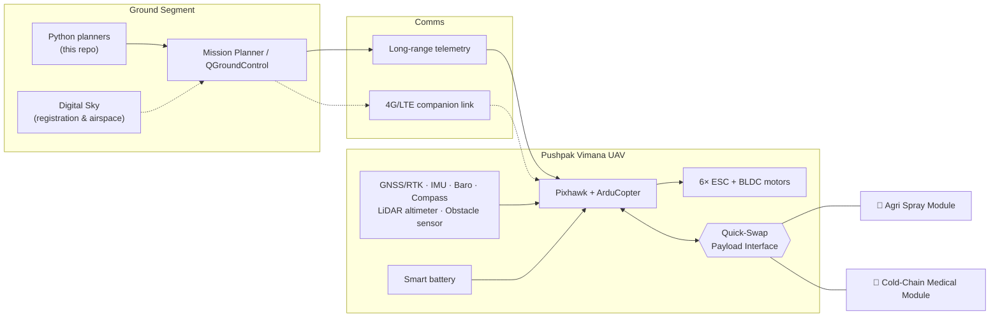
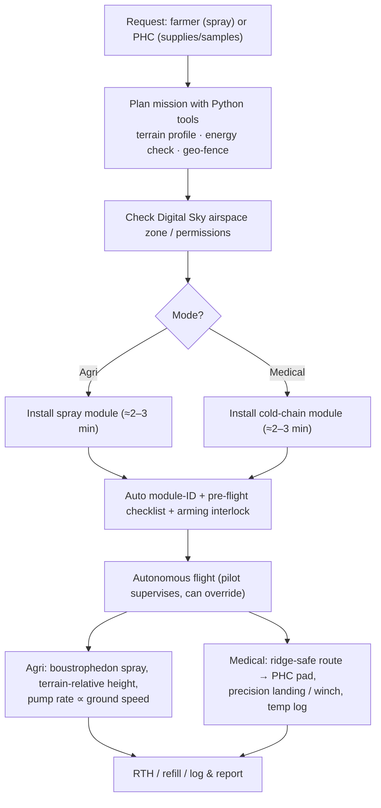

# 🚁 Pushpak Vimana

### A Dual-Purpose Autonomous Drone Framework for Precision Agriculture & Rural Healthcare

> Open-source UAV framework for the mountains of Uttarakhand: **one airframe, two life-saving jobs, swapped in 2–3 minutes.**


> ⚠️ **Status & safety notice.** This is a research and educational project prepared as part of a BSERC internship. Performance figures in this repository are **design targets**, not measured results. Never fly any aircraft built from this repository without simulation, bench testing, DGCA-compliant registration/permissions and a certified remote pilot.

---

## 1. Overview

Hill districts face two recurring problems at the same time:

| Problem | On the ground |
|---|---|
| **Slow last-mile healthcare** | Landslides, snow and winding roads delay ambulances. Anti-venom, vaccines and blood samples reach (or leave) remote Primary Health Centres (PHCs) late. |
| **Inefficient, hazardous farming inputs** | Small terraced plots, labour shortage, knapsack spraying that exposes farmers to chemicals and wastes water. |

**Pushpak Vimana** answers both with a modular multirotor and a **Quick-Swap Payload Mechanism**:

| Mode | Payload | Purpose |
|---|---|---|
| 🌾 **Agri Spray Mode** | 5 L spray module (pump, flow sensor, nozzles) | Precision application of nano urea / liquid fertiliser / approved crop-protection agents with less water and no farmer exposure |
| 🏥 **Healthcare Logistics Mode** | Insulated 2–8 °C cold-chain box + temperature logger + release/winch | Emergency medicines, anti-venom, vaccines, blood samples to and from remote PHCs |

Because the same aircraft works all year (sprayer in season, medical courier during monsoon/snow closures), it is economically viable for community owners such as **Self-Help Groups (SHGs)** and **FPOs**.

## 2. Key Features

- Carbon-fibre **hexacopter** (quadcopter variant) built for hill crosswinds, **3–5 kg modular payload**
- **ArduPilot / Pixhawk** open-source flight stack, autonomous waypoint missions via **Mission Planner / QGroundControl**
- **Quick-swap payload interface**: mechanical dovetail + keyed connector + auto module-ID + arming interlock
- **Terrain-following** (SRTM terrain DB + downward LiDAR) and **obstacle avoidance** (forward radar/depth)
- **Geo-fencing**, **Return-to-Home** failsafes for low battery, RC/GCS link loss, GNSS/EKF failure
- Terrain-aware **path-planning scripts** (clearance profile, gradient limits, energy check, spray coverage)
- Compliance-first design aligned with **DGCA Drone Rules, 2021** and the **Digital Sky** platform

## 3. System Architecture



**Layers:** (1) airframe & propulsion → (2) avionics & sensors → (3) swappable payload modules → (4) ground segment & mission planning.

## 4. Dual-Use Operational Workflow



**Quick-swap procedure (target 2–3 min):** power down → release 2 lock pins → unplug keyed connector → seat new module → lock & check indicator → connect → power up → confirm module ID on GCS → run checklist.

## 5. Hardware & Software Stack

### Hardware (reference configuration)

| Subsystem | Choice |
|---|---|
| Frame | Carbon-fibre hexacopter, foldable arms |
| Flight controller | Pixhawk-class (Cube Orange / Pixhawk 6X) |
| Navigation | Dual GNSS (RTK optional), compass, baro, redundant IMUs |
| Propulsion | 6 × high-torque BLDC + folding props, thrust-to-weight ≥ 2:1 **at operating altitude** |
| Power | 12S Li-ion / LiPo smart packs, hot-swap |
| Sensors | Downward LiDAR rangefinder, forward mmWave radar / depth camera |
| Comms | Long-range telemetry (legal Indian band) + 4G/LTE companion computer |
| Safety | Geo-fence, RTH, optional parachute, anti-collision lights |
| Payload A | 5 L tank, diaphragm pump, flow sensor, 2–4 nozzles |
| Payload B | EPS/VIP insulated box, PCM packs, temperature logger, servo release / winch |

### Software

| Layer | Tools |
|---|---|
| Autopilot | ArduPilot **ArduCopter** 4.x |
| Ground station | Mission Planner (Windows) · QGroundControl (cross-platform) |
| Simulation | ArduPilot **SITL**, MAVProxy |
| Planning | Python 3.9+ (standard library only) – `path-planning-scripts/` |
| Optional | `pymavlink` / MAVSDK for direct upload, QGIS for DEM & field polygons |
| Terrain data | SRTM / Copernicus DEM (ESRI ASCII grid supported) |

## 6. Repository Structure

```
pushpak-vimana/
├── README.md
├── LICENSE                        # add MIT or Apache-2.0 before publishing
├── docs/
│   ├── Pushpak_Vimana_Proposal.pdf   # exported project proposal / report
│   ├── regulatory/                   # DGCA checklist, SOPs, Digital Sky notes
│   └── diagrams/                     # architecture & workflow figures
├── firmware-sim/
│   ├── params/pushpak_vimana_baseline.parm   # ArduPilot failsafe/fence/terrain params
│   └── sitl/run_sitl_hexa.sh                 # SITL launcher (Haldwani start point)
├── path-planning-scripts/
│   └── terrain_mission_planner.py    # delivery + spray mission generator
├── cad-models/
│   ├── airframe/                     # hexacopter frame (STEP/STL)
│   └── payload-interface/            # quick-swap rail, pins, connector mount
├── payload-modules/
│   ├── agri-spray/                   # tank, pump, nozzle designs & calibration
│   └── medical-cold-chain/           # cold-box thermal tests, logger firmware
├── hardware/                         # BOM, wiring diagrams, power budget
├── data/dem/                         # place DEM tiles here (not committed if large)
└── tests/
    └── test_planner.py
```

## 7. Getting Started

### 7.1 Run the mission planner (no hardware needed)

```bash
git clone https://github.com/<your-username>/pushpak-vimana.git
cd pushpak-vimana/path-planning-scripts

# Healthcare delivery (outbound + return, energy check, RTL altitude)
python terrain_mission_planner.py delivery \
    --origin 29.2183,79.5130 --dest 29.2450,79.5400 \
    --payload-kg 4 --clearance 60 --out demo_delivery

# Agricultural spraying (boustrophedon, terrain-relative height)
python terrain_mission_planner.py spray \
    --polygon "29.2200,79.5100;29.2200,79.5108;29.2206,79.5108;29.2206,79.5100" \
    --swath 4 --height 3 --speed 4 --rate-l-ha 10 --out demo_spray
```

Without `--dem` the tool uses a **synthetic demo terrain**. For real planning pass an ESRI ASCII grid (EPSG:4326): `--dem data/dem/area.asc`.

**What the delivery planner does**

1. Samples the route every 25 m and reads ground elevation from the DEM
2. Builds *terrain + clearance* profile with a ±2-sample safety window
3. Enforces climb (≤ 20°) and descent (≤ 15°) gradient limits
4. Simplifies to the fewest waypoints that never fall below the required clearance
5. Runs an energy check (out + back, payload mass, climb, headwind, 25 % reserve)
6. Computes a safe RTL altitude from the highest terrain on the route
7. Writes `*.waypoints` (QGC WPL 110) for Mission Planner / QGroundControl

**What the spray planner does:** clips parallel tracks (swath-spaced) to the field polygon, alternates direction (snake pattern), uses `MAV_FRAME_GLOBAL_TERRAIN_ALT` waypoints for constant spray height, optionally gates the pump with `DO_SET_RELAY`, and reports area, volume, required pump flow and tank trips.

### 7.2 Simulate in ArduPilot SITL

```bash
# one-time: install ArduPilot + SITL per https://ardupilot.org/dev/docs/SITL-setup-landing-page.html
export ARDUPILOT_DIR=$HOME/ardupilot
./firmware-sim/sitl/run_sitl_hexa.sh

# in the MAVProxy console:
wp load ../../path-planning-scripts/demo_delivery_outbound.waypoints
mode guided
arm throttle
takeoff 10
mode auto
```

Test failsafes in SITL: battery (`param set SIM_BATT_VOLTAGE …`), link loss (`rc 3 0` / stop GCS), geo-fence breach, GPS failure.

### 7.3 Fly on real hardware (checklist)

1. Bench: thrust stand, motor/ESC calibration, pump calibration, cold-box thermal test
2. Load `firmware-sim/params/pushpak_vimana_baseline.parm`, then tune (autotune, battery voltages, rangefinder)
3. Tethered hover with ballast payload → open-field autonomous flights → failsafe drills
4. Register on **Digital Sky**, check airspace zone, hold required certificates (see §8)

### 7.4 Tests

```bash
python -m unittest discover -s tests -v
```

## 8. Regulatory & Safety Compliance (India)

- Governed by **Drone Rules, 2021** (and amendments) – DGCA / Ministry of Civil Aviation; airspace via **Digital Sky** (Green / Yellow / Red zones).
- **Weight class:** DGCA categories are Nano ≤ 250 g, Micro ≤ 2 kg, **Small ≤ 25 kg**, Medium ≤ 150 kg, Large > 150 kg. A 3–5 kg payload hexacopter (AUW ≈ 12–18 kg) is a **Small** drone. Nano/Micro relaxations do **not** apply; only small trainer/test airframes may qualify as Nano/Micro.
- Requirements to verify for the current rule set: type certification (or approved R&D route), registration/UIN, remote pilot certificate from a DGCA-authorised RPTO, zone permissions, altitude limits, and special permission for **BVLOS** operations.
- Spraying: use only products approved for drone application. Medical: coordinate with state health authorities and follow drug/vaccine handling protocols.
- Always re-check official sources: <https://www.dgca.gov.in> · <https://digitalsky.dgca.gov.in>

## 9. Roadmap

- [x] Concept, architecture, project proposal
- [x] Terrain-aware delivery & spray mission planner
- [x] Baseline ArduPilot parameters and SITL launcher
- [ ] Real-DEM (SRTM) validation on Uttarakhand routes
- [ ] CAD for quick-swap payload interface; prototype build
- [ ] Bench & field test campaign; spray uniformity and cold-chain trials
- [ ] Precision landing at PHC pads (IR beacon / ArUco)
- [ ] BVLOS permission pathway with state health & civil-aviation authorities
- [ ] SHG-operated pilot hub; operator training programme
- [ ] Fleet dashboard, swarm spraying, multispectral crop-health module

## 10. Contributing

Pull requests are welcome: planners, SITL scenarios, CAD, payload designs, documentation, field data. Please open an issue first for major changes, keep the safety notice intact and add tests for planner changes.

## 11. License

Choose and add a `LICENSE` file (MIT or Apache-2.0 recommended) before publishing.

## 12. Acknowledgements & References

- BSERC internship programme and mentors
- ArduPilot, MAVLink, Mission Planner and QGroundControl communities
- Ministry of Civil Aviation / DGCA, Digital Sky platform
- NASA SRTM elevation data

---

*"Pushpak Vimana" – inspired by the mythical aerial chariot, reimagined as a tool for health and farming in the Himalayas.*
